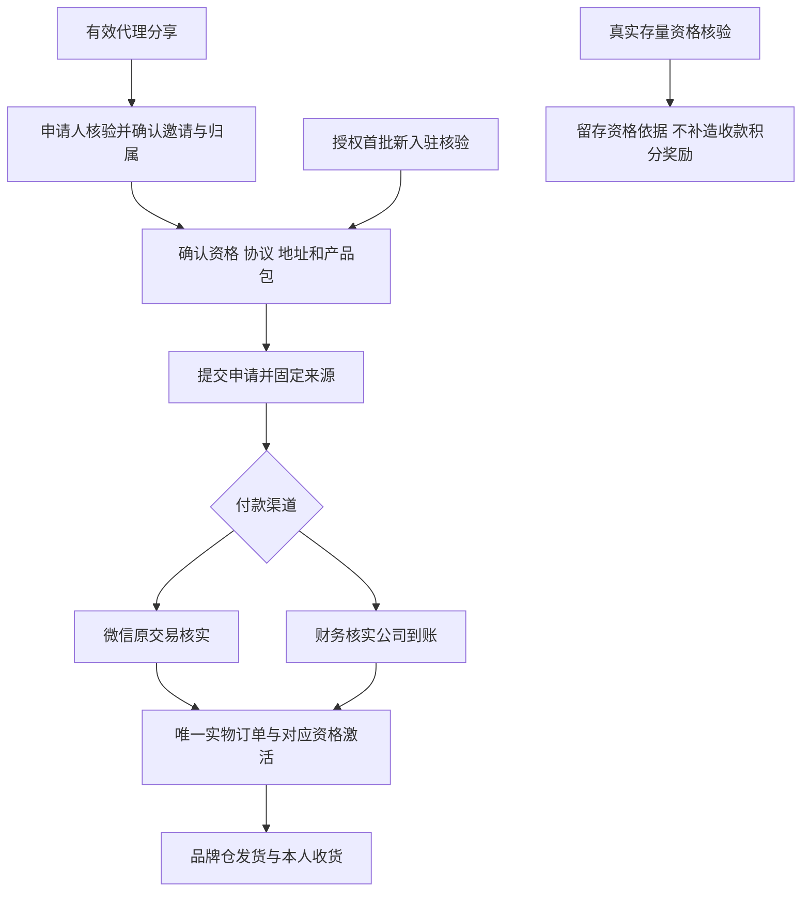
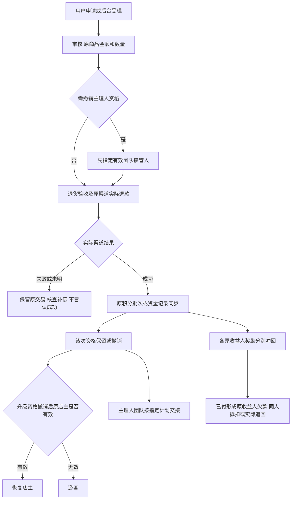

# V2 页面与业务流程

本稿记录已实施界面的入口、操作和状态，配合原生小程序／Vue源码作为本轮设计交付。截图来自专用隔离数据库的真实后台，不代表正式品牌数据、真实微信交易或微信真机视觉验收。

## 小程序页面

| 入口 | 页面及关键操作 | 状态与反馈 |
| --- | --- | --- |
| 首页 | 身份产品包、商品、已发布品牌内容推荐、课程权益入口 | 未登录可浏览；未配置显示真实空态 |
| 商城 | 普通／福利品、适用身份价、购物袋和结算 | 报价统一；销售代理逐单确认，不永久绑定顾客 |
| 种草空间 | 品牌已审核图文／短视频、详情、商品关联、朋友及朋友圈分享 | 草稿、下架内容不可公开访问；视频失败可重试 |
| 我的→代理入驻 | 产品包对比、邀请核验、协议和地址、确认提交、微信付款／公司转款、资格历史 | 未付款不取得权益；未决交易查询原单；关系变化重新确认 |
| 我的→邀请伙伴 | 本人真实随机分享码及入驻路径 | 仅有效代理，登录后保留候选关系 |
| 我的→订单售后 | 本人订单商品、数量、原因提交及进度查询 | 受理不代表退款；服务端核定数量金额，失败不显示成功 |
| 我的→团队 | 归属店主、限定订货信息、本人收益、直接邀请主理人名单与状态 | 仅有效主理人；不包含电话地址、钱包、凭证或他人收益 |
| 我的→课程权益 | 身份权益介绍、成长权益、联系与报名指引 | 按有效身份选取，不提供报名管理或学习系统 |

底部导航为首页、商城、种草空间、我的。原生页面继续使用现有品牌排版及胶囊／底部安全区处理。

## 后台页面

| 页面 | 本轮设计及实现 |
| --- | --- |
| 产品包与入驻 | 实物明细与分摊、到账激活、首批存量核验／新申请、团队接管、关系调整 |
| 商品与分类 | 普通零售价及计算后身份价、统一福利价及商品类型 |
| 品牌种草内容 | 草稿编辑→审核→发布；关联商品、图文／视频、下架与逻辑移除 |
| 课程成长权益 | D／C／B分别配置介绍、权益、联系方法和报名指引 |
| 奖励与结算 | 按来源展示不同收益人，人工登记、可结算检查、月结、冲回与同人追回 |
| 对应业务导出 | 沿查询权限和白名单字段，金额单位清楚，操作留痕 |

## 入驻与升级

## 实际退款与资格恢复

## 浏览器截图

截图为1440×1000桌面视口，接口结果见本目录 `v2/`。入驻列表对长处理说明最多展示三行，详情保留全文，避免挤压操作列。只展示隔离库后台；小程序以原生编译检查及真实设备后续验收为准。

- [产品包与资格办理](v2/membership.png)
- [品牌种草内容](v2/content.png)
- [课程权益配置](v2/courses.png)
- [奖励与结算](v2/rewards.png)
- [浏览器及导出实际检查结果](v2/browser-results.json)
